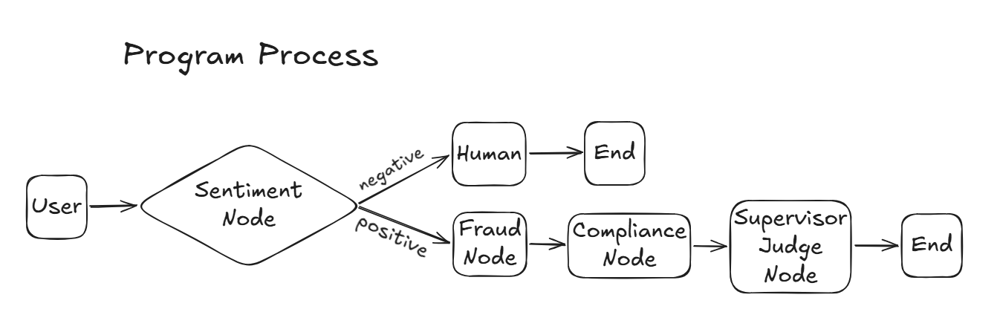
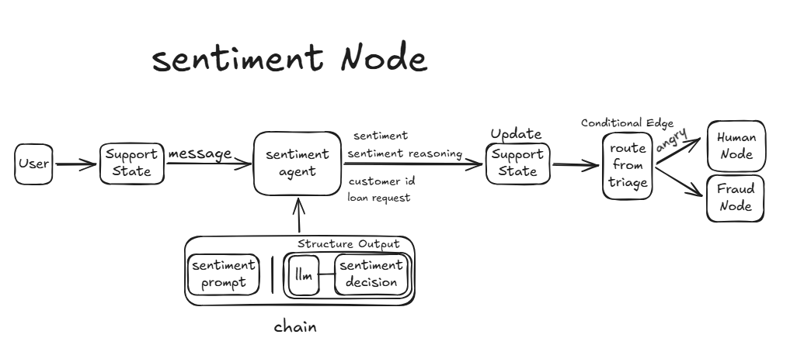
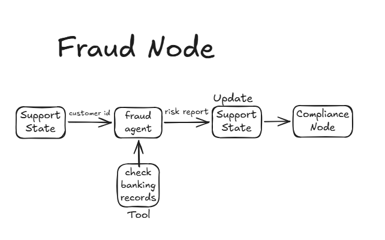
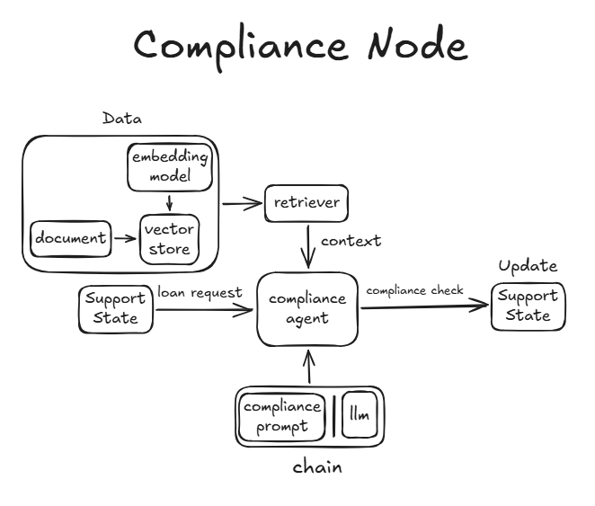
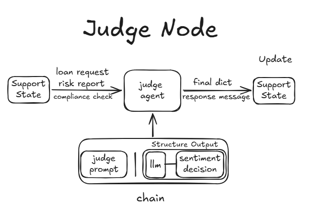
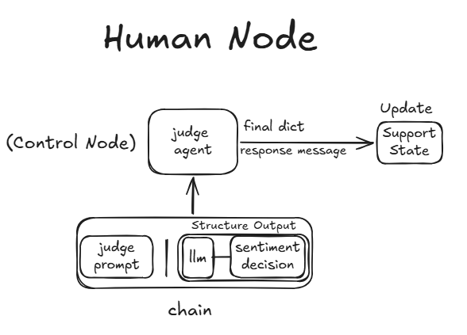

# 🏦 Persian Multi-Agent Credit Committee & Fraud Detection System

An enterprise-grade, stateful multi-agent system designed for automated Persian banking credit evaluation, fraud check, regulatory compliance assessment, and loan decision-making. Built with **LangGraph**, **LangChain**, **Qwen 2.5 (Ollama)**, **FAISS Vector Search**, and **Pydantic Structured Outputs**, tailored specifically for native Persian (Farsi) prompts and banking rules.

---

## 🌟 Architecture & Workflow

The system evaluates loan requests through a multi-tiered pipeline of specialized autonomous agents:



### 🔄 Execution Flow
1. **Front-Desk / Sentiment Agent:** Analyzes customer sentiment in Persian, extracts national ID numbers (`customer_id`), and loan details using structured schema. Escalates angry/dissatisfied users immediately to human branch managers.
2. **Fraud & Risk Agent:** Connects to banking mock databases via custom tools (`check_banking_records`) to check credit scores, blacklists, and bounced check histories.
3. **Compliance Agent (RAG):** Performs semantic search over Persian regulatory banking circulars using FAISS and HuggingFace Embeddings (`intfloat/multilingual-e5-base`) to evaluate loan limits and collateral requirements.
4. **Supervisor / Judge Agent:** Serves as the Credit Committee President, merging risk reports and compliance analysis to issue final `Approved` or `Rejected` decisions with detailed reasoning in Persian.
5. **Human Escalation Node:** Handles high-friction customer interactions to preserve customer satisfaction.

---

## 🔍 Detailed Node Breakdown

### 1. Sentiment / Front-Desk Node


### 2. Fraud & Risk Node


### 3. Compliance Node (RAG Pipeline)


### 4. Judge / Decision-Maker Node


### 5. Human Interruption / Escalation Node


---

## 📁 Project Structure

```text
├── persian_credit_committee.ipynb     # Main notebook containing LangGraph architecture
├── circulars/                         # Local Persian banking regulations & guidelines (.txt)
├── overall_architecture/              # Workflow & node diagrams (1.png to 6.png)
└── README.md                          # Technical documentation
